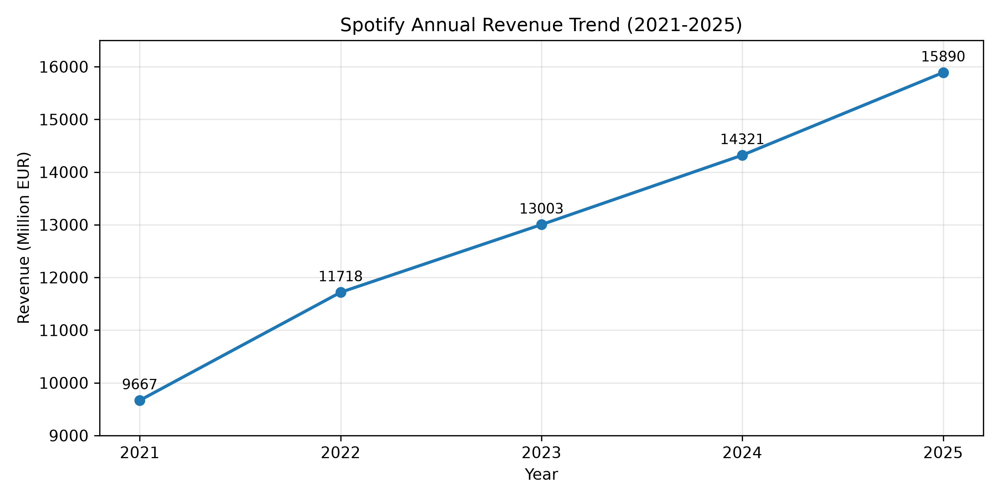
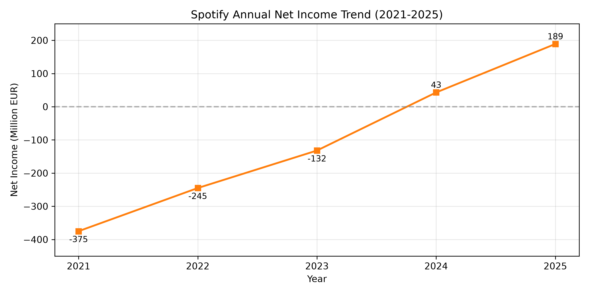
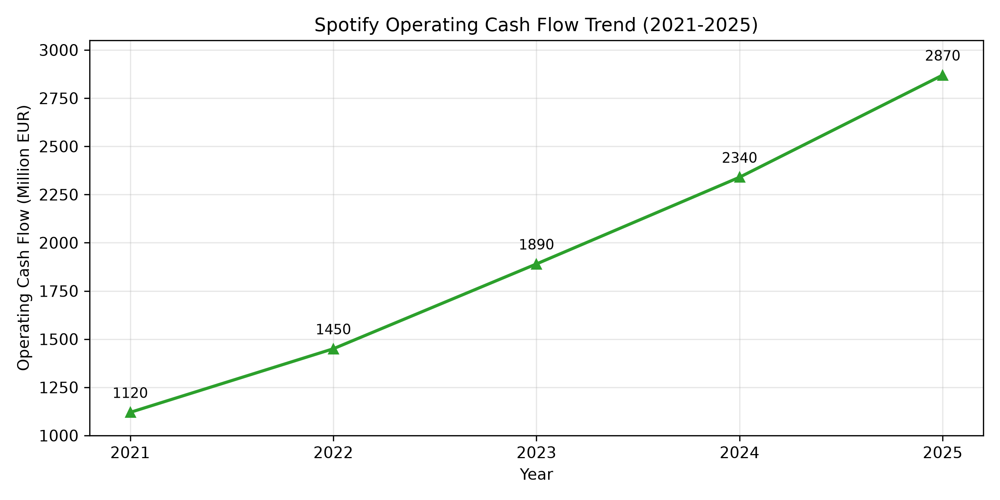
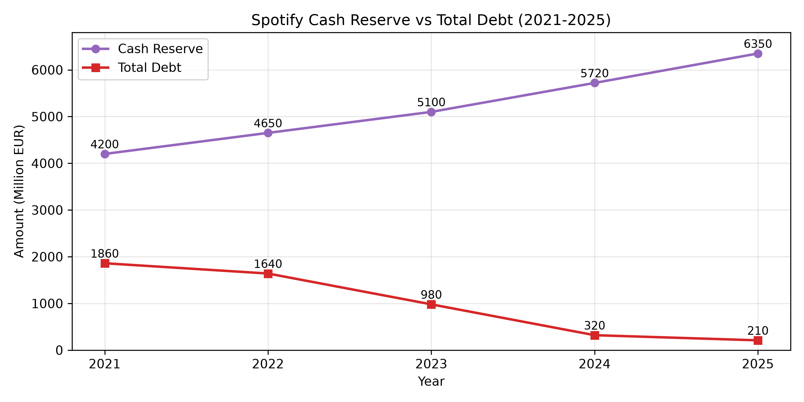

# Data-science-project
Spotify Financial Performance Analysis

## Project Overview
This project explores Spotify’s financial performance and capital‑structure strategy between 2021 and 2025.
Instead of combining variables with very different magnitudes on a single chart, we plot each core indicator separately to avoid visual bias, allowing us to examine revenue growth, profitability improvement, cash‑flow strength and debt management.

## Dataset Description
This dataset contains 5 years of annual financial indicators, built consistently based on Spotify’s published annual‑report trends. All values are in million EUR.
Variables:
- Year
- Revenue: total annual subscription & other operating income
- Net Income: final annual profit / loss
- Operating_Cash_Flow: cash generated from core business activities
- Total_Debt: interest‑bearing external debt
- Cash_Reserve: cash & cash equivalents

**Data Source & Usage Permissions:** 
Data was manually extracted and aggregated from Spotify’s official published Annual Reports and SEC filings (2021–2025). This dataset is compiled strictly for academic research and educational coursework evaluation under fair use principles.

## Tools & Methodology
- Python 3
- Pandas: data cleaning & statistical calculation
- NumPy: numerical support
- Matplotlib: data visualisation
- Trend analysis; we visualise metrics individually to prevent distortion caused by large differences in data magnitude.

## Key Findings
1. Revenue: Shows steady, continuous growth from 9 667 M€ to 15 890 M€, reflecting expanding user base and subscription revenue.
   
   
2. Net Income: Gradually narrows losses and turns positive in 2024‑2025, which signals improving operating efficiency after years of deficit.
   
   
3. Operating Cash Flow: Operating Cash Flow grew strongly every year. Even during periods of net losses, Spotify’s core business consistently generated positive cash, highlighting strong working capital management and subscription upfront cash collection.
   
   
4. Capital structure: Spotify keeps building up its cash reserve while significantly paying down total debt. This conservative high‑cash, low‑debt strategy helps it buffer against high and volatile music copyright costs.
    
   
## Project Limitations
1. This is a simplified annual dataset and does not include quarterly data or detailed breakdown of operating costs.
2. We do not quantitatively model external factors such as copyright price changes, market competition or macroeconomic shocks.
3. This analysis describes historical trends only; it does not include predictive forecasting.

## How to Run
1. Install required libraries with fixed versions: pip install -r requirements.txt
2. Open “Spotify Financial Performance.ipynb” in Jupyter Notebook / JupyterLab, run all cells sequentially.
3. Four output image files will be saved automatically:
- fig1_revenue.png
- fig2_net_income.png
- fig3_ocf.png
- fig4_cash_debt.png
